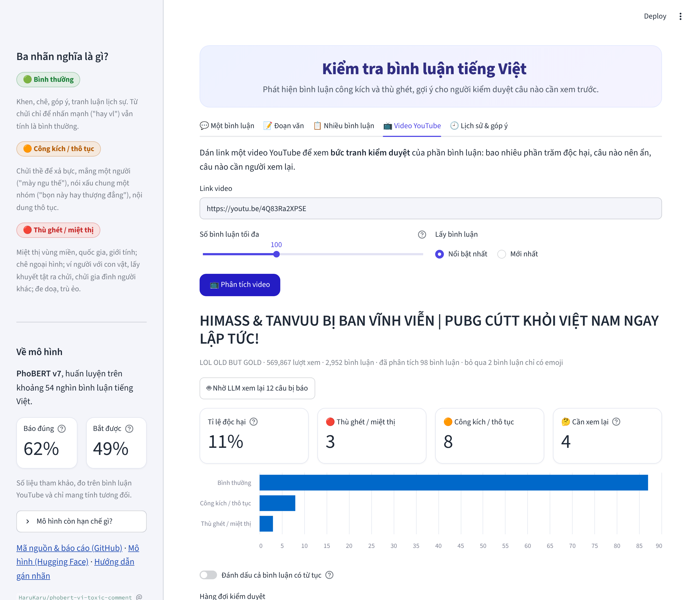
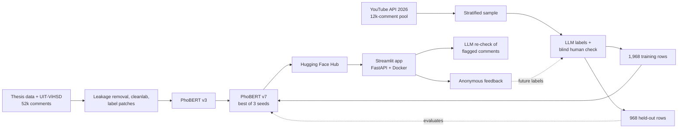

<h1 align="center">Vietnamese Toxic Comment Moderation</h1>

<p align="center">
  A moderation assistant for Vietnamese social-media comments: a fine-tuned PhoBERT classifier,<br>
  an optional LLM second opinion, and a web app that turns a YouTube comment section into a review queue.
</p>

<p align="center">
  <a href="https://github.com/Harukaru1/vietnamese-toxic-comment-moderation/actions/workflows/ci.yml"></a>
  <a href="https://vi-toxic-moderation.streamlit.app/"></a>
  <a href="https://huggingface.co/HaruKaru/phobert-vi-toxic-comment"></a>
  
  <a href="LICENSE"></a>
</p>

<p align="center"><b><a href="https://vi-toxic-moderation.streamlit.app/">Try the live demo →</a></b></p>

<p align="center"></p>

## Contents

- [What it does](#what-it-does)
- [Results](#results)
- [How it works](#how-it-works)
- [How the project got here](#how-the-project-got-here)
- [Limitations](#limitations)
- [Repository structure](#repository-structure)
- [Quickstart](#quickstart)
- [Data and licences](#data-and-licences)

## What it does

Every comment gets one of three labels, defined in a written
[annotation guideline](docs/annotation_guidelines.md):

| Label | Meaning | Example |
|---|---|---|
| **clean** | No one is insulted. Criticism, sarcasm and profanity used for emphasis are clean. | "Phim hay vl, xem 3 lần rồi" |
| **offensive** | An insult at a person, a sweeping remark about a group, or swearing in anger. | "Mày ngu thế, nói mãi không hiểu à" |
| **hate** | A severe attack: on who someone is, dehumanizing, or threatening. | "Bọn này ngu như chó, cút hết về nước đi" |

The web app offers four ways to use the model:

| Mode | What you get |
|---|---|
| **Single comment** | Label, confidence for each class, the text as the model sees it, and a 👍/👎 feedback button |
| **Paragraph** | Each sentence classified and highlighted; the paragraph takes its most severe confident sentence |
| **CSV file** | Upload a file with a `text` column, download it back with labels and confidence |
| **YouTube video** | Paste a link: share of toxic comments and three queues (*suggest hiding*, *needs review*, *leave*), with an optional LLM re-check and per-comment corrections |

<p align="center">
  
  
</p>

It is built to **prioritize a human moderator's work**, not to remove comments on its own.

## Results

The main benchmark is a set of **968 YouTube comments from 2026** that were never used for training
or tuning. It is a stratified sample of a 12k-comment pool, so the scores are weighted back to the
pool and describe real traffic, where about 1 comment in 20 is toxic. The metric is toxic vs clean,
the decision a moderator actually makes.

| Model | Precision | Recall | F1 |
|---|---:|---:|---:|
| PhoBERT v3: 52k older comments | 0.36 | 0.44 | 0.40 |
| **PhoBERT v7** (deployed): v3 + 2k comments labeled under the final guideline | **0.62** | **0.49** | **0.55** |

The gain is +0.15 F1 with a 95% paired-bootstrap interval of [+0.07, +0.24]
([`reports/testset2_heldout.json`](reports/testset2_heldout.json)).

**LLM second opinion.** The app can send only the comments the classifier flags (about 6% of
traffic) to an LLM that applies the same guideline. On 111 flagged comments labeled blind by the
author ([`reports/llm_second_stage.json`](reports/llm_second_stage.json)):

| Flagged by | Human also says toxic | Toxic comments kept |
|---|---:|---:|
| PhoBERT alone | 46% | 100% |
| PhoBERT, confirmed by Gemini Flash-Lite | **69%** | 84% |

This sample deliberately over-represents hard cases; read the two rows against each other.

**Label quality.** An LLM (Claude) labeled the data and the author labeled 241 comments blind.
Cohen's κ is 0.74 for toxic vs clean and 0.68 for the three classes
([`reports/annotation_agreement_testset2.json`](reports/annotation_agreement_testset2.json)).

<details>
<summary><b>Earlier benchmarks</b> (older label definitions, three-class F1-macro)</summary>

| Model | In-domain test | 2026 set 1 | ViHSD test | Training data |
|---|---:|---:|---:|---|
| TF-IDF + Linear SVM | 0.799 | – | 0.616 | classic baseline |
| PhoBERT v1 | 0.780 | – | 0.643 | original thesis data |
| PhoBERT v2 | 0.801 | 0.556 | 0.690 | + leakage removal, label-noise pruning, UIT-ViHSD |
| PhoBERT v3 | 0.815 | 0.647 | 0.674 | + guideline v3, 772 labels fixed |
| PhoBERT v4 | 0.804 | 0.641 | 0.683 | + 821 active-learning comments |
| PhoBERT v5 | 0.781 | 0.635 | 0.673 | + 163 labels fixed, text-artifact fix |

In-domain, TF-IDF and PhoBERT are tied; PhoBERT only pulls ahead on unseen sources. v4 and v5 were
within noise of v3 (paired bootstrap) and were not deployed. Exact files are in [`reports/earlier/`](reports/earlier/).
</details>

## How it works



| Component | Details | Code |
|---|---|---|
| Preprocessing | Unicode NFC, lowercase, URL/mention/emoji removal, squeezing repeated letters, pyvi word segmentation. Emoji-only comments skip the model. | [`preprocess.py`](src/toxic_moderation/preprocess.py) |
| Classifier | `vinai/phobert-base-v2`. v3: lr 2e-5, up to 6 epochs. v7: continue v3 for 3 epochs at lr 1e-5 on the newly labeled comments, three seeds, keep the best on validation. | [`train_phobert.py`](scripts/train_phobert.py), [`notebooks/`](notebooks/) |
| Decision bands | P(toxic) ≥ 0.8 → suggest hiding; 0.4–0.8 → needs review; below → leave. | [`streamlit_app.py`](streamlit_app/streamlit_app.py) |
| LLM second stage | Gemini re-reads flagged comments with the guideline in the prompt; retries on rate limits and falls back to the classifier alone. | [`llm_check.py`](src/toxic_moderation/llm_check.py) |
| Paragraphs | Split into sentences, classify each, take the most severe confident one. | [`segment.py`](src/toxic_moderation/segment.py) |
| Swear-word flag | A separate word list, off by default: under the guideline most comments with a swear word are clean, so it is kept apart from the toxicity label. | [`profanity.py`](src/toxic_moderation/profanity.py) |
| Feedback loop | Votes and corrections are stored anonymously (no name or IP, opt-out) in a private Hugging Face dataset. | [`feedback_store.py`](src/toxic_moderation/feedback_store.py) |
| Evaluation | Inverse-probability weights for the stratified sample, paired bootstrap for every comparison, Cohen's κ for every annotation round. | [`eval_heldout.py`](scripts/eval_heldout.py), [`agreement_testset2.py`](scripts/agreement_testset2.py) |

## How the project got here

The project started from a graduation-thesis prototype. Most of the work went into the data and
the measurement rather than the model.

1. **Leakage.** 4.7% of the test set also appeared in train, inflating F1 by about 0.03. Removed.
2. **Label noise.** [cleanlab](https://github.com/cleanlab/cleanlab) flagged 5.5% of the labels; a
   manual review of 120 found a third clearly wrong. They were pruned from train only.
3. **A fresh test set.** A model scoring 0.80 in-domain scored 0.59 on 1,000 comments collected in
   2026 (YouTube Data API and the VOZ forum).
4. **One root cause for the weak *offensive* class.** Comments containing the intensifier "vl" were
   labeled 52% clean, 25% offensive and 23% hate. A written guideline fixed the rule and 772 labels
   were corrected through a public patch that stores only row indices ([`relabels/`](relabels/)).
   F1 on the 2026 set rose from 0.59 to 0.68.
5. **Two retraining rounds that did not help.** An active-learning batch (v4), then more label fixes
   and a text-artifact fix (v5): both within noise of v3, so neither was deployed. The 2026 set was
   too small to resolve differences that size.
6. **A larger test set and a blind check.** 12k new YouTube comments, 2,000 sampled and labeled. The
   author's blind labels showed where the guideline and human judgement diverged; the guideline was
   revised and then frozen ([v3.3](docs/annotation_guidelines.md)).
7. **What worked.** On the new set every earlier version raised about two false alarms per real
   hit, because the older training labels treat harsh criticism as toxic. Continuing v3 on about
   2,000 comments labeled under the final guideline fixed more than relabeling inside the 52k older
   ones had.

## Limitations

- **It prioritizes, it does not decide.** At precision 0.62 a person should confirm before anything
  is hidden.
- **One comment, no context.** "bạn mập quá đấy" can be teasing or body shaming.
- **Offensive vs hate is a judgement of severity.** The model separates toxic from clean far better
  than it separates the two toxic classes; the app shows that split as an indication only.
- **Subjective labels.** One LLM and one human, with measured agreement.
- **The LLM stage depends on an external API** and its rate limits.

## Repository structure

```
src/toxic_moderation/   preprocessing, predictor, sentence splitting, LLM check, swear-word flag, feedback store, YouTube client
scripts/                data pipeline, training, evaluation, annotation agreement, test-set sampling
notebooks/              Kaggle GPU notebooks, one per model version (v1-v7)
streamlit_app/          Streamlit demo (deployed on Streamlit Community Cloud)
app/                    FastAPI service + Gradio UI, Dockerfile at the repo root
docs/                   annotation guidelines, screenshots
relabels/, labels/      label patches and test-set labels (ids + labels only, no text)
reports/                JSON results behind every number in this README (older experiments in earlier/)
tests/                  pytest suite, run by GitHub Actions on every push
```

## Quickstart

```bash
python -m venv .venv && source .venv/bin/activate
pip install -r requirements.txt -r requirements-app.txt && pip install -e .
pytest
```

**Use the model**

```python
from toxic_moderation.predictor import Predictor

clf = Predictor(revision="v7")   # downloads HaruKaru/phobert-vi-toxic-comment from the Hugging Face Hub
clf.predict(["Video rất hay và bổ ích", "Đá như này thì nghỉ mẹ đi cho rồi"])
# [{'label': 'clean', 'scores': {...}}, {'label': 'offensive', 'scores': {...}}]
```

**Run the demo or the API**

```bash
streamlit run streamlit_app/streamlit_app.py
uvicorn app.main:app --port 7860          # API docs at http://localhost:7860/docs
docker build -t toxic-mod . && docker run -p 7860:7860 toxic-mod
```

```bash
curl -X POST localhost:7860/predict -H "Content-Type: application/json" \
     -d '{"texts": ["Video rất hay và bổ ích"]}'
```

On CPU a single comment takes about 40 ms.

**Optional keys** (Streamlit secrets or environment variables; the app works without any of them):

| Name | Enables |
|---|---|
| `YOUTUBE_API_KEY` | the YouTube tab |
| `GEMINI_API_KEY` | the LLM re-check button |
| `HF_TOKEN` | saving anonymous feedback to a private dataset |

**Reproduce the data pipeline** (needs the private thesis splits in `data/raw/`, see
[`data/README.md`](data/README.md)):

```bash
python scripts/find_label_issues.py
python scripts/make_clean_splits.py --prune
python scripts/add_vihsd.py
python scripts/apply_relabels.py --src data/clean_vihsd --dst data/clean_vihsd_v3
python scripts/train_baseline.py --data-dir data/clean_vihsd_v3
```

PhoBERT training runs on Kaggle with the notebooks in `notebooks/`.

## Data and licences

The **code** is released under the [MIT License](LICENSE). The licence does not cover any data.
No comment text is published in this repository. The thesis data is private; UIT-ViHSD is
CC BY-NC-SA 4.0 and VOZ-HSD is for research use; YouTube comments are collected through the
official API and are not redistributed (author names are never stored). Only code, aggregate
results and label patches (row indices) are committed.

## References

- Nguyen & Nguyen (2020). *PhoBERT: Pre-trained language models for Vietnamese.* Findings of EMNLP.
- Luu et al. (2021). *A Large-scale Dataset for Hate Speech Detection on Vietnamese Social Media Texts* (UIT-ViHSD).
- Northcutt et al. (2021). *Confident Learning: Estimating Uncertainty in Dataset Labels.* JAIR.
- Vu et al. (2020). *HSD Shared Task in VLSP Campaign 2019.*
- Zampieri et al. (2019). *Predicting the Type and Target of Offensive Posts in Social Media* (OLID).
