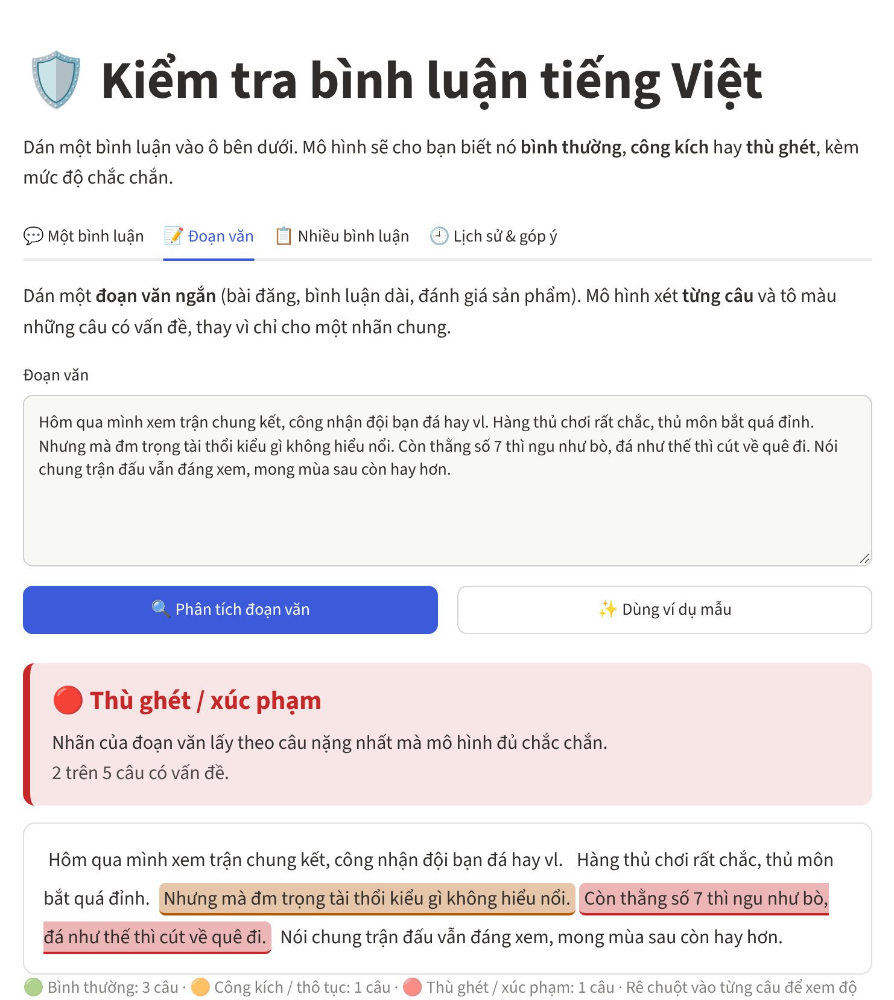
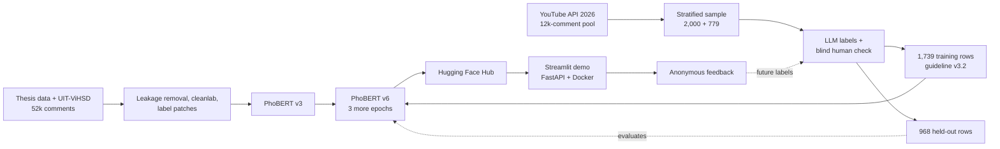

# Vietnamese Toxic Comment Moderation

[](https://github.com/Harukaru1/vietnamese-toxic-comment-moderation/actions/workflows/ci.yml)
[](https://vi-toxic-moderation.streamlit.app/)
[](https://huggingface.co/HaruKaru/phobert-vi-toxic-comment)

[](LICENSE)

A 3-class classifier for Vietnamese social-media comments (**clean / offensive / hate**), taken from
a graduation-thesis prototype to a deployed, evaluated moderation tool. Most of the work went into
the **data and the measurement**: removing leakage and label noise, writing an annotation guideline
and checking it against blind human labels, and building two fresh test sets from 2026 YouTube and
forum comments. The model was a small part of the story.

**[Try the live demo →](https://vi-toxic-moderation.streamlit.app/)**

<p align="center"></p>

<p align="center"></p>
<p align="center"><em>Short-paragraph mode: the paragraph takes the label of its most severe sentence the model is confident about; low-confidence hits only raise a "needs review" flag.</em></p>

## Highlights

- **Tested on new data, not only on a held-out split.** A model that scored 0.80 F1-macro in-domain
  scored 0.59 on 1,000 comments collected in 2026. Every later step came from analysing that gap.
- **Data problems found and fixed.** 4.7% of the test set leaked from train; one profanity token
  (`vl`) was labeled clean, offensive *and* hate; a thesis-era text artifact had replaced a swear
  word in ~1,700 rows.
- **Negative results reported.** Two retraining rounds (v4, v5) brought no measurable gain and were
  not deployed. A second, larger test set then showed that all versions shared the same weakness.
- **What finally worked was small.** Continuing the deployed model for 3 epochs on 1,739 comments
  labeled under the current guideline raised toxic-comment precision from 0.28 to 0.45 at slightly
  higher recall (v6, paired bootstrap ΔF1 +0.125, 95% CI [+0.045, +0.223]).
- **Every comparison has a confidence interval; every annotation round has a Cohen's κ.**
- **Shipped.** Hugging Face Hub (one branch per version), Streamlit app with single-comment,
  paragraph, batch and YouTube-video modes plus anonymous feedback, FastAPI + Docker, CI.

## Results

**Test set 2** is the main benchmark: 968 held-out YouTube comments from 2026 (guideline v3.2),
never used for training or tuning. It is a stratified sample of a 12k-comment pool, so scores are
weighted back to the pool with inverse-probability weights and describe real traffic, where about
5% of comments are toxic. The primary metric is binary (toxic vs clean), because that is where two
annotators agree best (κ 0.84).

| Model | Toxic precision | Toxic recall | Toxic F1 | F1 offensive | F1 hate |
|---|---:|---:|---:|---:|---:|
| PhoBERT v3 | 0.28 | 0.45 | 0.35 | 0.26 | 0.17 |
| PhoBERT v5 | 0.28 | 0.42 | 0.34 | 0.27 | 0.17 |
| **PhoBERT v6** (deployed) | **0.45** | **0.50** | **0.47** | **0.51** | **0.28** |

With a threshold of 0.8 on P(toxic), v6 reaches precision 0.62 at recall 0.36; the demo uses that
for "suggest hiding" and sends the 0.4–0.8 band to a human (`reports/threshold_v6.json`).

Earlier benchmarks, F1-macro over three classes (older guideline versions):

| Model | In-domain test | 2026 set 1 | ViHSD test | Training data |
|---|---:|---:|---:|---|
| TF-IDF + Linear SVM | 0.799 | – | 0.616 | classic baseline |
| PhoBERT v1 | 0.780 | – | 0.643 | original thesis data |
| PhoBERT v2 | 0.801 | 0.556 | **0.690** | + leakage removal, label-noise pruning, UIT-ViHSD |
| PhoBERT v3 | **0.815** | **0.647** | 0.674 | + guideline v3, 772 labels fixed |
| PhoBERT v4 | 0.804 | 0.641 | 0.683 | + 821 active-learning comments (no gain) |
| PhoBERT v5 | 0.781 | 0.635 | 0.673 | + 163 labels fixed, text-artifact fix (no gain) |

In-domain numbers use slightly different label versions per row; exact files are in `reports/`.
All models are `vinai/phobert-base-v2` fine-tuned on a Kaggle T4. Model selection uses validation
data only.

What the numbers say:

- **In-domain, PhoBERT and TF-IDF are tied.** PhoBERT's advantage only shows on unseen sources.
- **v2–v5 are indistinguishable on test set 2** (toxic F1 0.40–0.42 unweighted, overlapping CIs).
  Fixing a few hundred labels inside 52k older ones did not move the model.
- **v6 trades a little on the older benchmark**: on 2026 set 1 its toxic F1 is 0.58 against 0.63
  for v3. Part of that is the changed hate/offensive definition, part is forgetting.
- **Hate is still weak** (F1 0.28): only 78 hate examples exist under the current guideline. A
  learning-curve check (half the new data) shows toxic-vs-clean has stopped improving with more
  data, while hate has not.

## How it works



**Preprocessing** (`src/toxic_moderation/preprocess.py`): Unicode NFC, lowercase, URL/mention/emoji
removal, squeezing repeated characters ("vlllll" → "vl"), word segmentation with pyvi. Comments
with no text left (emoji only) are returned as clean without calling the model.

**Model** (`scripts/train_phobert.py`): PhoBERT-base-v2. v1–v5: lr 2e-5, up to 6 epochs, best
validation F1-macro. v6: start from v3, lr 1e-5, 3 epochs on the new labels only.

**Labels** ([`docs/annotation_guidelines.md`](docs/annotation_guidelines.md)): *hate* attacks
someone for who they are (region, nationality, gender, appearance…) or threatens them; *offensive*
insults a person without that, or is crude venting; profanity used only as an intensifier
("đẹp vl") is *clean*.

## The data story

Each step below has its numbers in `reports/` and its code in `scripts/`.

**1. Leakage and label noise.** 178 test comments (4.7%) also appeared in train, which inflated
F1-macro by about 0.03 (0.820 → 0.793 for TF-IDF + LR after removal).
[cleanlab](https://github.com/cleanlab/cleanlab) flagged 5.5% of labels; a manual review of 120
found a third clearly wrong. They were pruned from train only.

**2. More data.** [UIT-ViHSD](https://huggingface.co/datasets/ura-hcmut/UIT-ViHSD) train/dev were
added; its test set is kept as an outside benchmark.

**3. 2026 test set 1.** 1,000 comments (700 YouTube via the official API, 300 from the VOZ forum).
An LLM (Claude) labels every comment; the author labels a random subset blind.

**4. The weak *offensive* class had one root cause.** Comments containing `vl` were labeled 52%
clean, 25% offensive, 23% hate. Guideline v3 fixed the rule and 772 labels were changed through a
public patch that stores only row indices ([`relabels/`](relabels/)). 2026 F1-macro: 0.594 → 0.679.

**5. Two rounds that did not help (v4, v5).** An active-learning batch of 821 comments, then 163
more label fixes and a text-artifact fix ("đéo" had been replaced by "bad" in ~1,700 rows, found by
the author during a blind check). Both models were within noise of v3 (paired bootstrap CIs
[−0.068, +0.051] and [−0.067, +0.041]) and v5 raised more false alarms. Lesson: the 2026 set, with
48 hate comments, could not resolve differences that small.

**6. Test set 2 and a changed definition.** 12k new YouTube comments were collected and 2,000
sampled (random, model-flagged, cue words). The author's blind labels agreed poorly with the
guideline on one pattern, insults at one person ("m ngu"): the guideline called them *hate*, the
author *offensive*. The guideline was changed (v3.2, in line with VLSP 2019 and OLID) and the set
re-labeled.

| Annotation round | Blind subset | κ before | κ after the guideline fix |
|---|---:|---:|---:|
| 2026 set 1 | 100 | 0.72 | 0.91 |
| Active-learning batch | 50 | 0.47 | 0.84 |
| Re-labeled training rows | 50 | 0.42 | 0.59 |
| Test set 2 (3 classes / binary) | 84 | 0.41 / 0.61 | 0.70 / 0.84 |

**7. v6.** On test set 2 every earlier version flagged about 7 clean comments for every 3 toxic
ones: the older training labels call harsh criticism of wrongdoers toxic. No decision threshold
fixed that (`reports/threshold_v3.json`). Half of test set 2 plus 779 more pool comments became
training data, and v3 was trained for 3 more epochs on those alone.

The demo stores each 👍/👎 anonymously (no name or IP, opt-out) in a private Hugging Face dataset
(`src/toxic_moderation/feedback_store.py`) for future labeling rounds.

Project report and study guide in Vietnamese: [`docs/bao_cao_du_an.md`](docs/bao_cao_du_an.md),
[`docs/tai_lieu_hoc.md`](docs/tai_lieu_hoc.md).

## Limitations

- **Precision 0.45 means the model prioritizes, it does not decide.** It is meant to order a
  moderator's queue, not to remove comments automatically.
- **One comment, no context.** "bạn mập quá đấy" can be teasing or body shaming.
- **Subjective labels.** One LLM and one human; agreement is measured, not perfect.
- **Hate vs offensive is unreliable** (few hate examples under the current definition).
- **Run-to-run variance.** Two v6 runs with the same data gave precision 0.45 and 0.53.

## Repository structure

```
src/toxic_moderation/   preprocessing, teencode dictionary, features, evaluation, predictor, YouTube client
scripts/                data pipeline, training, evaluation, annotation agreement, active learning
notebooks/              Kaggle GPU notebooks, one per model version (v1-v6)
streamlit_app/          Streamlit demo (deployed on Streamlit Community Cloud)
app/                    FastAPI service + Gradio UI, Dockerfile at the repo root
docs/                   annotation guidelines, project report and study guide (Vietnamese), screenshots
relabels/, labels/      label patches and test-set labels (ids + labels only, no text)
reports/                JSON results of every experiment quoted in this README
tests/                  pytest suite, run by GitHub Actions on every push
```

## Quickstart

```bash
python -m venv .venv && source .venv/bin/activate
pip install -r requirements.txt -r requirements-app.txt && pip install -e .
pytest
```

**Use the model**

```python
from toxic_moderation.predictor import Predictor

clf = Predictor(revision="v6")   # downloads HaruKaru/phobert-vi-toxic-comment from the Hugging Face Hub
clf.predict(["Video rất hay và bổ ích", "Đá như này thì nghỉ mẹ đi cho rồi"])
# [{'label': 'clean', 'scores': {...}}, {'label': 'offensive', 'scores': {...}}]
```

**Run the demo or the API**

```bash
streamlit run streamlit_app/streamlit_app.py
uvicorn app.main:app --port 7860          # API docs at http://localhost:7860/docs
docker build -t toxic-mod . && docker run -p 7860:7860 toxic-mod
```

```bash
curl -X POST localhost:7860/predict -H "Content-Type: application/json" \
     -d '{"texts": ["Video rất hay và bổ ích"]}'
```

On CPU a single comment takes about 40 ms.

**Reproduce the data pipeline** (needs the private thesis splits in `data/raw/`, see
[`data/README.md`](data/README.md)):

```bash
python scripts/find_label_issues.py
python scripts/make_clean_splits.py --prune
python scripts/add_vihsd.py
python scripts/apply_relabels.py --src data/clean_vihsd --dst data/clean_vihsd_v3
python scripts/train_baseline.py --data-dir data/clean_vihsd_v3
```

PhoBERT training runs on Kaggle with the notebooks in `notebooks/`.

## Next steps

- More *hate* examples under guideline v3.2 (the class that still improves with data).
- Averaging several fine-tuning runs to reduce run-to-run variance.
- A context-aware model (parent comment + reply).

## Data and licences

The **code** is released under the [MIT License](LICENSE). The licence does not cover any data.
No comment text is published in this repository. The thesis data is private; UIT-ViHSD is
CC BY-NC-SA 4.0 and VOZ-HSD is for research use; YouTube comments are collected through the
official API and are not redistributed (author names are never stored). Only code, aggregate
results and label patches (row indices) are committed.

## References

- Nguyen & Nguyen (2020). *PhoBERT: Pre-trained language models for Vietnamese.* Findings of EMNLP.
- Luu et al. (2021). *A Large-scale Dataset for Hate Speech Detection on Vietnamese Social Media Texts* (UIT-ViHSD).
- Northcutt et al. (2021). *Confident Learning: Estimating Uncertainty in Dataset Labels.* JAIR.
- Vu et al. (2020). *HSD Shared Task in VLSP Campaign 2019.*
- Zampieri et al. (2019). *Predicting the Type and Target of Offensive Posts in Social Media* (OLID).
