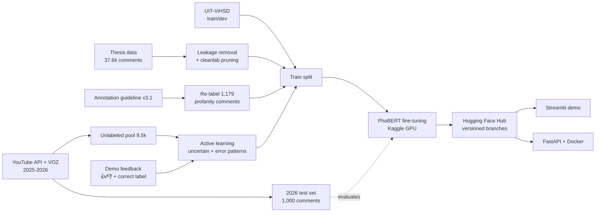

# Vietnamese Toxic Comment Moderation

[](https://github.com/Harukaru1/vietnamese-toxic-comment-moderation/actions/workflows/ci.yml)
[](https://vi-toxic-moderation.streamlit.app/)
[](https://huggingface.co/HaruKaru/phobert-vi-toxic-comment)

[](LICENSE)

A 3-class classifier for Vietnamese social-media comments (**clean / offensive / hate**), taken from
a graduation-thesis prototype to a deployed, evaluated system. Most of the work went into the
**data**: finding leakage and label noise, writing a consistent annotation guideline, building a
fresh real-world test set from 2025–2026 YouTube and forum comments, and closing the loop with
active learning and user feedback from the demo.

**[Try the live demo →](https://vi-toxic-moderation.streamlit.app/)**

<p align="center"></p>

## Highlights

- **Real-world evaluation, not just a held-out split.** On a new set of 1,000 comments from 2026
  (YouTube Data API + VOZ forum), the first model scored **0.59 F1-macro** against 0.80 in-domain.
  The error analysis behind that gap drove every later iteration.
- **Data quality first.** Found that **4.7% of the test set leaked from train** (inflating F1 by
  ~0.03), flagged 5.5% likely label errors with confident learning, and traced the weak *offensive*
  class to one root cause: the same profanity token (`vl`) was labeled clean, offensive *and* hate.
- **Measured, not guessed.** Bootstrap confidence intervals on every comparison; Cohen's κ for
  every annotation round (LLM-assisted labels, blind human checks).
- **Iterative fixes with clear gains.** Guideline v3 + re-labeling 772 comments lifted real-world
  F1-macro from **0.594 to 0.679** (paired bootstrap 95% CI [+0.015, +0.153]) and toxic-comment
  precision from 0.71 to 0.82.
- **Shipped.** Model on the Hugging Face Hub, Streamlit app with feedback collection, FastAPI +
  Docker service, GitHub Actions CI.

## Results

F1-macro on three test sets. The in-domain test set is our own leakage-free split; the 2026 set is
the out-of-time, out-of-platform benchmark; ViHSD is a public dataset from another source.

| Model | In-domain test | **2026 real-world** | ViHSD test | Notes |
|---|---:|---:|---:|---|
| TF-IDF + Linear SVM | 0.799 | – | 0.616 | strong classic baseline |
| PhoBERT v1 | 0.780 | – | 0.643 | original data, class-weighted loss |
| PhoBERT v2 | 0.801 | 0.594² | **0.690** | + leakage removal, label-noise pruning, UIT-ViHSD |
| **PhoBERT v3** (deployed) | **0.815**¹ | **0.679**² | 0.674 | + guideline v3, 772 labels fixed |
| PhoBERT v4 | 0.804 | 0.641³ | 0.683 | + 821 active-learning comments; **not deployed** (no gain, see §5) |

¹ On the v3-labeled test split (v2 scores 0.796 on the same split).
² Guideline v3 labels. After the v3.1 clarification (13 *hate* → *clean*), v2 scores 0.556 and v3 0.647.
³ Guideline v3.1 labels; compare with v3's 0.647 (paired bootstrap Δ −0.006, 95% CI [−0.068, +0.051]).
All PhoBERT models are `vinai/phobert-base-v2`, fine-tuned on a Kaggle T4. Model selection always
uses the validation split; each test set is used once per model.

What the numbers say:

- **In-domain, PhoBERT and TF-IDF are tied** (differences < 0.015 are within the bootstrap CI).
  PhoBERT's advantage only appears on unseen sources, which is why the 2026 set matters.
- **The ViHSD drop from v2 to v3 is deliberate**: ViHSD labels intensifier profanity ("đẹp vl",
  *very pretty*) as offensive, while our guideline labels it clean.
- **Remaining weak spot: implicit hate** (no profanity: regional slurs, gender stereotypes,
  threats, body shaming). Hate F1 on the 2026 set is still ~0.4–0.5; v4 did not fix it (§5).

## How it works



**Preprocessing** (`src/toxic_moderation/preprocess.py`): Unicode NFC, lowercase, URL/mention/emoji
removal, squeezing repeated characters ("vlllll" → "vl"), then word segmentation with pyvi for
PhoBERT. A 650-entry teencode dictionary is included, but the ablation below shows it does not help.

**Model** (`scripts/train_phobert.py`): PhoBERT-base-v2, max length 160, lr 2e-5, 6 epochs with
early stopping on validation F1-macro. Removing the class-weighted loss fixed the over-prediction
of *offensive* (precision 0.52 → 0.62).

## The data story

### 1. Leakage and label noise

178 test comments (4.7%) and 211 validation comments appeared verbatim in train, mostly spam-like
toxic comments posted many times; 11 of them with conflicting labels.

| TF-IDF + LR | Test F1-macro | Test F1 offensive |
|---|---:|---:|
| original splits (with leakage) | 0.820 | 0.710 |
| leakage-free splits | **0.793** | **0.647** |

[cleanlab](https://github.com/cleanlab/cleanlab) on 5-fold out-of-fold probabilities flagged 2,076
comments (5.5%; 11.6% of *offensive*). A manual review of 120 of them: 34% clearly mislabeled, 30%
ambiguous under the thesis guideline, 36% correct. Pruning them from **train only** gave +0.007
test F1-macro. Scripts: `find_label_issues.py` → `make_clean_splits.py --prune`.

### 2. More data: UIT-ViHSD

[UIT-ViHSD](https://huggingface.co/datasets/ura-hcmut/UIT-ViHSD) (Luu et al., 2021) uses the same
three labels. Its train/dev sets (22.5k after removing overlaps) were added to our train split; its
test set (6.4k) is kept as an out-of-domain benchmark. In-domain F1 is unchanged, ViHSD test F1
goes from 0.659 to 0.690 (the thesis model scored 0.60 there).

### 3. A fresh real-world test set (2026)

1,000 comments posted in 2025–2026: 700 from 20 YouTube videos in 8 categories (news, society,
football, showbiz, gaming, music, tech, film) via the official YouTube Data API, and 300 from the
VOZ forum ([VOZ-HSD](https://huggingface.co/datasets/tarudesu/VOZ-HSD)). Anything seen in training
is removed (`scripts/build_realworld_set.py`). The set is very imbalanced, like real traffic:
YouTube is 96% clean, VOZ 78%.

**Annotation** follows [`docs/annotation_guidelines.md`](docs/annotation_guidelines.md). An LLM
(Claude) pre-annotates every comment, and the author labels a random subset **blind**:

| Round | Blind subset | Independent κ | Outcome |
|---|---:|---:|---|
| 2026 test set | 100 | **0.72** | guideline v3: profanity used only as an intensifier is clean |
| Active-learning batch | 50 | **0.47** | guideline v3.1: criticism of behaviour without insults is clean |

The second round was harder by design (only uncertain comments); all disagreements were discussed,
the guideline was updated, and both the batch and the 2026 set were re-checked under the new rule.

### 4. Root cause of the weak *offensive* class

Comments containing `vl` were labeled 52% clean, 25% offensive and 23% hate in the training data
(`má` 39/19/43, `éo` 26/22/52). The model could not learn a boundary the labels did not have.
Guideline v3 fixed the rule; 1,179 matching comments were re-reviewed and **772 labels changed**.
The patch stores only row indices and labels ([`relabels/guidelines_v3.csv`](relabels/guidelines_v3.csv)),
so it is public while the data stays private.

| Training labels | In-domain F1 offensive | 2026 F1-macro (PhoBERT) |
|---|---:|---:|
| original (v2) | 0.629 | 0.594 |
| guideline v3 (v3) | **0.679** | **0.679** |

### 5. Active learning and user feedback (v4: a negative result)

`scripts/build_active_pool.py` collected 9.5k new comments (39 YouTube videos chosen for topics
where implicit hate is common, plus VOZ; none overlap the test set), scored them with v3, and picked
817 to label: the most uncertain, those with hate cues the model called clean, those it called toxic,
a random slice, and comments matching **error patterns reported through the demo's feedback
button** (body shaming, an intensifier aimed at a person such as "m béo vl", lone regional slurs).
The labeled batch is added to train only (`scripts/add_active_labels.py`, repeated ×3).

**It did not help.** v4 is within noise of v3 everywhere: 2026 set 0.641 vs 0.647 (paired bootstrap
Δ −0.006, 95% CI [−0.068, +0.051], `scripts/bootstrap_compare.py`), in-domain 0.804 vs 0.815, ViHSD
0.683 vs 0.674. It trades precision for recall on the 2026 set (hate recall 16 → 23 of 48, but
toxic precision 0.68 → 0.55), and only 34 of 1,000 predictions change. On 33 hand-written probe
sentences targeting the reported errors (none in train), v4 fixes 1 (a lone regional slur): body
shaming and an intensifier aimed at a person ("m lùn vl") are still missed
(`reports/probe_v1_v3_vs_v4.json`).

The likely reason is the old training data: ~2.4k new rows cannot outvote ~50k rows that label the
same patterns inconsistently (for example, of 14 train comments with "mày/m … vl", *you … so*, 8 are
hate and 6 clean; a manual check is still needed to tell real inconsistency from context). The next step is therefore to re-label those patterns in the existing data under guideline
v3.1, not to add more new comments. v3 stays deployed; v4 is kept on the `v4` branch for reference.

The demo now closes the loop on its own: each 👍/👎 (and the label the user says is correct) is
saved **anonymously** (comment text, model scores, vote, model commit; no name or IP, and users can
opt out) to a private Hugging Face dataset through `huggingface_hub.CommitScheduler`
(`src/toxic_moderation/feedback_store.py`). `scripts/export_feedback.py` downloads it, keeps each
user's final vote and groups votes per comment for review under the guideline before any of it is
used for training.

<details>
<summary><b>Ablation: teencode normalization</b> (no measurable gain)</summary>

| Model | Teencode dictionary | Val F1-macro | Test F1-macro | Test F1 offensive |
|---|---|---:|---:|---:|
| TF-IDF + Logistic Regression | yes | 0.829 | 0.812 | 0.695 |
| TF-IDF + Linear SVM | no | 0.823 | 0.822 | 0.718 |
| PhoBERT | yes | 0.828 | 0.798 | 0.659 |
| PhoBERT | no | 0.843 | 0.801 | 0.662 |

Character n-grams and subword tokens already cover most spelling variants, and fine-tuning lets
PhoBERT learn slang directly (original splits, before leakage removal).
</details>

## Limitations

- **One comment, no context.** Whether "bạn mập quá đấy" (*you're quite chubby*) is teasing or body
  shaming depends on who says it to whom. Such comments are labeled by their surface meaning and
  flagged as uncertain; the demo sends low-confidence predictions to a "needs review" filter. A
  context-aware model (parent comment + reply) is future work.
- **Annotation is subjective.** Labels come from one LLM and one human with measured, not perfect,
  agreement (κ 0.47–0.72 before discussion). The 2026 set has only 48 *hate* comments, so per-class
  scores there have wide confidence intervals.
- **Not for automatic removal.** The model is meant to prioritize comments for human moderators.

## Repository structure

```
src/toxic_moderation/   preprocessing, teencode dictionary, features, evaluation, predictor, YouTube client
scripts/                data pipeline, training, evaluation, annotation agreement, active learning
notebooks/              Kaggle GPU notebooks, one per model version (v1-v4)
streamlit_app/          Streamlit demo (deployed on Streamlit Community Cloud)
app/                    FastAPI service + Gradio UI, Dockerfile at the repo root
docs/                   annotation guidelines, screenshots
relabels/               label patches (row indices + labels only)
reports/                JSON results of every experiment quoted in this README
tests/                  pytest suite, run by GitHub Actions on every push
```

## Quickstart

```bash
python -m venv .venv && source .venv/bin/activate
pip install -r requirements.txt -r requirements-app.txt && pip install -e .
pytest
```

**Use the model**

```python
from toxic_moderation.predictor import Predictor

clf = Predictor()   # downloads HaruKaru/phobert-vi-toxic-comment from the Hugging Face Hub
clf.predict(["Video rất hay và bổ ích", "Đá như này thì nghỉ mẹ đi cho rồi"])
# [{'label': 'clean', 'scores': {...}}, {'label': 'offensive', 'scores': {...}}]
```

**Run the demo or the API**

```bash
streamlit run streamlit_app/streamlit_app.py
uvicorn app.main:app --port 7860          # API docs at http://localhost:7860/docs
docker build -t toxic-mod . && docker run -p 7860:7860 toxic-mod
```

```bash
curl -X POST localhost:7860/predict -H "Content-Type: application/json" \
     -d '{"texts": ["Video rất hay và bổ ích"]}'
```

On CPU a single comment takes about 40 ms.

**Reproduce the data pipeline** (needs the private thesis splits in `data/raw/`, see
[`data/README.md`](data/README.md)):

```bash
python scripts/find_label_issues.py
python scripts/make_clean_splits.py --prune
python scripts/add_vihsd.py
python scripts/apply_relabels.py --src data/clean_vihsd --dst data/clean_vihsd_v3
python scripts/train_baseline.py --data-dir data/clean_vihsd_v3
```

PhoBERT training runs on Kaggle with the notebooks in `notebooks/`.

## Roadmap

- [x] TF-IDF baselines, PhoBERT fine-tuning, model on the Hugging Face Hub
- [x] Data audit: leakage removal, confident-learning label noise, UIT-ViHSD
- [x] 2026 real-world test set with LLM-assisted annotation and blind human checks
- [x] Guideline v3 and re-labeling; PhoBERT v3 deployed
- [x] Streamlit demo with anonymous shared feedback (private HF dataset); FastAPI + Docker; CI
- [x] PhoBERT v4 with an active-learning batch (no gain: documented as a negative result)
- [ ] Re-label inconsistent patterns (body shaming, insults with intensifiers) in the existing train data
- [ ] Short-text mode: split a paragraph into sentences and highlight the toxic ones
- [ ] Context-aware model (parent comment + reply)
- [ ] YouTube moderation dashboard (analyse all comments of a video)
- [ ] LLM zero/few-shot comparison (quality, latency, cost)

## Data and licences

The **code** is released under the [MIT License](LICENSE). The licence does not cover any data.
No comment text is published in this repository. The thesis data is private; UIT-ViHSD is
CC BY-NC-SA 4.0 and VOZ-HSD is for research use; YouTube comments are collected through the
official API and are not redistributed (author names are never stored). Only code, aggregate
results and label patches (row indices) are committed.

## References

- Nguyen & Nguyen (2020). *PhoBERT: Pre-trained language models for Vietnamese.* Findings of EMNLP.
- Luu et al. (2021). *A Large-scale Dataset for Hate Speech Detection on Vietnamese Social Media Texts* (UIT-ViHSD).
- Northcutt et al. (2021). *Confident Learning: Estimating Uncertainty in Dataset Labels.* JAIR.
