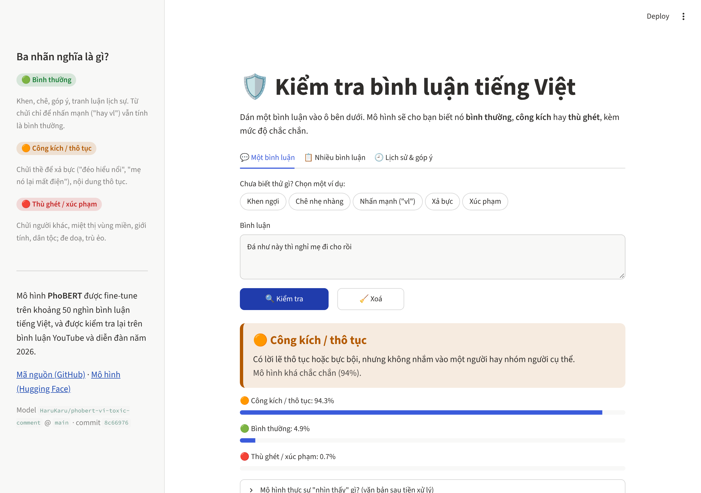

# Vietnamese Toxic Comment Moderation

Classify Vietnamese social-media comments as **clean / offensive / hate**, and compare
classic ML, a fine-tuned transformer (PhoBERT) and an LLM on the same test set.

> 🚧 Work in progress. Roadmap below.

**Live demo:** [vi-toxic-moderation.streamlit.app](https://vi-toxic-moderation.streamlit.app/) · **Model:** [HaruKaru/phobert-vi-toxic-comment](https://huggingface.co/HaruKaru/phobert-vi-toxic-comment)

<p align="center"></p>

## Dataset

~37.6k Vietnamese comments (built for my graduation thesis at UIT), 3 classes:

| Split | clean | offensive | hate | Total |
|---|---:|---:|---:|---:|
| train | 17,822 | 2,857 | 9,389 | 30,068 |
| val | 2,228 | 358 | 1,173 | 3,759 |
| test | 2,228 | 357 | 1,174 | 3,759 |

The data is not published (see [`data/README.md`](data/README.md)).

## Results (de-duplicated test set)

Each model family is selected on the **validation** set; the test set is used once for reporting.
All numbers below use the **leakage-free** splits (see *Data quality* below).

| Model | Training data | Test F1-macro | Test accuracy | Test F1 offensive | ViHSD test F1-macro |
|---|---|---:|---:|---:|---:|
| TF-IDF + Logistic Regression | de-duplicated | 0.793 | 0.861 | 0.648 | – |
| TF-IDF + Linear SVM | cleaned (leakage + label errors removed) | 0.799 | 0.865 | **0.662** | 0.616 |
| TF-IDF + Logistic Regression | cleaned + ViHSD | 0.797 | – | 0.661 | 0.667 |
| PhoBERT v1 (class-weighted loss) | original | 0.780 | 0.853 | 0.608 | 0.643 |
| PhoBERT v2-C (no class weights) | cleaned | **0.801** | 0.873 | 0.640 | 0.659 |
| PhoBERT v2 (deployed until Nov 2026) | cleaned + ViHSD | **0.801** | **0.873** | 0.640 | **0.690** |

The currently deployed model is **PhoBERT v3** (v2 + relabeled data, see
[*Fixing the profanity labels*](#fixing-the-profanity-labels-guidelines-v3)); its test set uses the
v3 labels, so it is reported separately below. v2 was selected on validation (v2 and v2-C tie at 0.830 val F1-macro; v2 is preferred
because it generalizes better to another source). Key improvements over v1:

- **Removing the class-weighted loss** fixed the over-prediction of *offensive*:
  precision 0.52 → 0.62, test F1-macro 0.780 → 0.801.
- **Adding ViHSD** leaves the in-domain score unchanged but improves the out-of-domain
  ViHSD test from 0.659 to **0.690** (my thesis model: 0.60 on the same test set).
- On in-domain data, PhoBERT and a well-tuned TF-IDF model are statistically tied; PhoBERT's
  advantage shows up on unseen sources.

The hardest class is **offensive**: it is the smallest class (8% of comments) and overlaps with *hate*.
With 281 offensive comments in the test set, differences below ~0.015 F1-macro are within
the bootstrap 95% confidence interval and should not be over-interpreted.

## Data quality: leakage and label noise

**1. Train → test leakage.** 178 test comments (4.7%) and 211 validation comments (5.6%) also
appear verbatim in the training set, mostly toxic comments that were posted repeatedly.
11 texts appear with *conflicting* labels. Removing them shows the original scores were inflated:

| TF-IDF + LR | Test F1-macro | Test F1 offensive |
|---|---:|---:|
| original splits (with leakage) | 0.820 | 0.710 |
| leakage-free splits | 0.793 | 0.647 |

**2. Label noise (confident learning).** Out-of-fold probabilities from 5-fold cross-validation
were passed to [cleanlab](https://github.com/cleanlab/cleanlab), which flagged **2,076 comments
(5.5%)** as likely mislabeled; the *offensive* class has the highest rate (11.6%).
A manual review of 120 flagged training comments (20 per confusion type) against the
annotation guidelines found:

| Review outcome | Share |
|---|---:|
| clearly mislabeled | 34% |
| ambiguous under the guidelines | 30% |
| label was correct | 36% |

The ambiguous cases come from an overlap in the guidelines: both *offensive* ("attacks an
issue, organization or person") and *hate* ("heavy language insulting or discriminating against
a group or someone") cover insults aimed at a person, and profanity without a target
(e.g. "đm hay vãi", which is actually praise) is labeled inconsistently.

**3. Effect.** Pruning the flagged comments from **train only** (val/test untouched) improves
TF-IDF on both validation (+0.008) and test (+0.007 F1-macro, +0.013 F1 offensive).

Reproduce: `scripts/find_label_issues.py` → `scripts/make_clean_splits.py [--prune]`.

## More data: adding UIT-ViHSD

[UIT-ViHSD](https://huggingface.co/datasets/ura-hcmut/UIT-ViHSD) (Luu et al., 2021; CC BY-NC-SA 4.0)
uses the same clean / offensive / hate scheme. Its train + dev sets (22.5k comments after removing
anything that overlaps our splits or the ViHSD test set) were added to **our train only**; the
ViHSD test set (6.4k) is kept aside as an **out-of-domain benchmark**.

| Model | Training data | Our test F1-macro | ViHSD test F1-macro |
|---|---|---:|---:|
| TF-IDF + LR | ours (cleaned) | 0.801 | 0.603 |
| TF-IDF + LR | ours (cleaned) + ViHSD | 0.797 | **0.667** |
| PhoBERT v1 | ours (original) | 0.780 | 0.643 |

More data does not move the in-domain score (the difference is within noise), but it clearly
improves robustness to comments from another source, which matters for a public demo.


## Real-world evaluation (2026 comments)

To check how the model behaves outside curated datasets, I built a fresh test set of
**1,000 comments posted in 2025–2026**: 700 from 20 YouTube videos in 8 categories (news, society,
football, showbiz, gaming, music, tech, film) collected with the official YouTube Data API, and 300
from the VOZ forum ([VOZ-HSD](https://huggingface.co/datasets/tarudesu/VOZ-HSD)).
Comments that appear in the training data were removed. See `scripts/build_realworld_set.py`.

**Annotation.** Labels follow [annotation guidelines v3](docs/annotation_guidelines.md). All 1,000 comments were pre-annotated by an LLM (Claude); a random 100-comment subset
was annotated blind by the author: on the 94 comments the author could label, raw agreement is
**95.7%** and **Cohen's κ = 0.72** (3-class; 0.78 binary toxic/clean), i.e. substantial agreement.
3 of the 4 disagreements are profanity used as an intensifier ("Đù anh Huấn", "thổi giá vcl"),
which the author labeled *clean* while guideline v2 said *offensive*. The guideline was therefore
revised (**v3**: profanity used only as an intensifier/exclamation is *clean*; *offensive* = crude
language used to vent or curse, with no target). After re-labeling under v3, agreement on the same
subset is κ = 0.91 — optimistic, since the rule was changed after seeing the disagreements; the
independent estimate remains κ = 0.72.

| Source (v3 labels) | clean | offensive | hate |
|---|---:|---:|---:|
| YouTube (700) | 96.4% | 0.4% | 3.1% |
| VOZ (300) | 78.0% | 9.0% | 13.0% |

**PhoBERT v2 on the 2026 set:**

| Labels | F1-macro | Accuracy | F1 offensive | F1 hate | Toxic precision / recall (binary) |
|---|---:|---:|---:|---:|---:|
| guideline v2 | 0.567 | 0.902 | 0.279 | 0.471 | 0.76 / 0.41 |
| guideline v3 | 0.594 | 0.924 | 0.346 | 0.471 | 0.71 / 0.50 |

F1-macro drops from 0.80 (in-domain test) to **0.59**, and the model misses half of the toxic
comments. Error analysis shows two causes:

1. **Inconsistent labels for profanity used as an intensifier in the training data.** The same
   token gets every label: comments containing `vl` are 52% *clean* / 25% *offensive* / 23% *hate*
   in train; `má` 39 / 19 / 43; `éo` 26 / 22 / 52. The model therefore treats "cười vl" or
   "Má nó đẹp" as clean. This is the root cause of the weak *offensive* class throughout the project.
2. **Implicit hate without profanity**: gender stereotypes ("incel thiếu hơi gái"), derogatory
   nicknames for countries ("Đông Lào", "Thái Lọ"), insults without swear words, and threats
   ("Nên đem số 22 đi hoả thiêu").

### Fixing the profanity labels (guidelines v3)

Comments matching simple profanity patterns were re-reviewed under guidelines v3: intensifier-only
comments labeled *offensive*/*hate*, and comments with curse words labeled *clean*. **1,179 comments**
(993 train, 88 val, 98 test) were reviewed and **772 labels changed** (e.g. 168 train comments
offensive → clean, 335 clean → offensive). The patch stores only row indices and labels
([`relabels/guidelines_v3.csv`](relabels/guidelines_v3.csv)) and is applied with
`scripts/apply_relabels.py`.

Quick check with TF-IDF + LR (same features, only the training labels differ):

| Training labels | v3 test F1-macro | v3 test F1 offensive | 2026 set F1-macro | 2026 set F1 offensive |
|---|---:|---:|---:|---:|
| original | 0.785 | 0.632 | 0.537 | 0.308 |
| **guidelines v3** | **0.797** | **0.663** | **0.559** | **0.364** |

Changing 2% of the labels gives a consistent gain on both test sets. *Hate* on the 2026 set stays
weak (F1 ≈ 0.36): implicit hate needs more real-world training data, not just cleaner labels.

### PhoBERT v3 (deployed)

PhoBERT v3 uses the same recipe as v2 (no class weights, 6 epochs, ViHSD added to train), trained on
the v3 labels ([notebook](notebooks/train_phobert_v3_kaggle.ipynb); HF branches `v2` and `v3` keep
both models).

| Test set | v2 F1-macro | **v3 F1-macro** | v2 → v3 F1 offensive | v2 → v3 F1 hate |
|---|---:|---:|---:|---:|
| Our test (v3 labels, 3,563) | 0.796 | **0.815** | 0.629 → 0.679 | 0.838 → 0.839 |
| **2026 real-world set (1,000)** | 0.594 | **0.679** | 0.346 → 0.581 | 0.471 → 0.484 |
| ViHSD test (6,435, ViHSD labels) | **0.690** | 0.674 | 0.430 → 0.455 | 0.580 → 0.626 |

- On the 2026 set, v3 gains **+0.085 F1-macro** (paired bootstrap 95% CI [+0.015, +0.153]); as a
  binary toxic filter, precision rises 0.71 → **0.82** and recall 0.50 → **0.59**.
- The small drop on ViHSD test is expected and accepted: ViHSD labels intensifier profanity
  ("đẹp vl") as *offensive*, which guideline v3 deliberately labels *clean*.
- *Hate* on real-world comments is still the weak point (F1 0.48, recall 0.38): consistent labels
  fixed *offensive*, but implicit hate needs more real-world training examples.

### Ablation: does teencode normalization help? (original splits)

| Model | Teencode dictionary | Val F1-macro | Test F1-macro | Test F1 offensive |
|---|---|---:|---:|---:|
| TF-IDF + Logistic Regression | yes | 0.829 | 0.812 | 0.695 |
| TF-IDF + Linear SVM | no | 0.823 | 0.822 | 0.718 |
| PhoBERT | yes | 0.828 | 0.798 | 0.659 |
| PhoBERT | no | 0.843 | 0.801 | 0.662 |

Result: **no measurable gain** for either model family. Character n-grams (TF-IDF) and
subword tokens (PhoBERT) already handle most spelling variants, and fine-tuning lets
PhoBERT learn slang directly from the data.

## Project structure

```
src/toxic_moderation/   preprocessing, teencode dictionary (650+ entries), evaluation, predictor
app/                    FastAPI service + Gradio UI (one app, Docker)
streamlit_app/          Streamlit demo (deployed on Streamlit Community Cloud)
scripts/                training / evaluation entry points
tests/                  unit tests (pytest)
notebooks/              Kaggle GPU notebooks (PhoBERT)
Dockerfile              CPU image for the API/demo (used by Hugging Face Spaces)
```

## Quickstart

```bash
python -m venv .venv && source .venv/bin/activate
pip install -r requirements.txt -r requirements-app.txt && pip install -e .
pytest
python scripts/train_baseline.py      # trains LR / SVM / RF, picks best on val, reports on test
```

### Run the API + demo

```bash
uvicorn app.main:app --port 7860      # demo: http://localhost:7860  |  API docs: http://localhost:7860/docs
```

```bash
curl -X POST localhost:7860/predict -H "Content-Type: application/json" \
     -d '{"texts": ["Video rất hay và bổ ích", "Đá như này thì nghỉ mẹ đi cho rồi"]}'
```

The model (`HaruKaru/phobert-vi-toxic-comment`) is downloaded from the Hugging Face Hub on the
first request. On CPU, a single comment takes ~40 ms.

Docker: `docker build -t toxic-mod . && docker run -p 7860:7860 toxic-mod`

### Run the Streamlit demo

```bash
pip install streamlit
streamlit run streamlit_app/streamlit_app.py
```

Single-comment mode and batch mode (paste lines or upload a CSV, download the labeled results).

## Roadmap

- [x] Clean project structure, preprocessing with teencode normalization, tests
- [x] TF-IDF baselines (Logistic Regression, Linear SVM, Random Forest)
- [x] Fine-tune PhoBERT on Kaggle GPU, publish model to Hugging Face Hub
- [x] Real-world 2026 test set (YouTube API + VOZ), LLM-assisted annotation
- [x] Inter-annotator agreement on a blind 100-comment subset (κ = 0.72)
- [x] Fix the profanity-label inconsistency (guidelines v3, 1,179 comments re-reviewed)
- [ ] Train PhoBERT v3 on the re-labeled data and compare with v2 on the 2026 set
- [ ] More real-world training data for implicit hate (active learning)
- [ ] YouTube moderation dashboard in the Streamlit app
- [ ] LLM zero/few-shot classification and comparison (quality, latency, cost)
- [x] FastAPI inference service + Docker
- [x] Streamlit demo (single + batch/CSV moderation, example chips, confidence-aware result card, "needs review" filter, 👍/👎 feedback with label correction and CSV export)
- [x] Deploy demo on Streamlit Community Cloud
- [x] CI with GitHub Actions (tests on every push; manual deploy to Hugging Face Spaces)
- [x] Data quality audit: leakage removal + confident learning label-noise detection
- [x] Add UIT-ViHSD as extra training data + out-of-domain benchmark
- [x] Retrain PhoBERT on cleaned data (+ ViHSD) → v2 deployed
