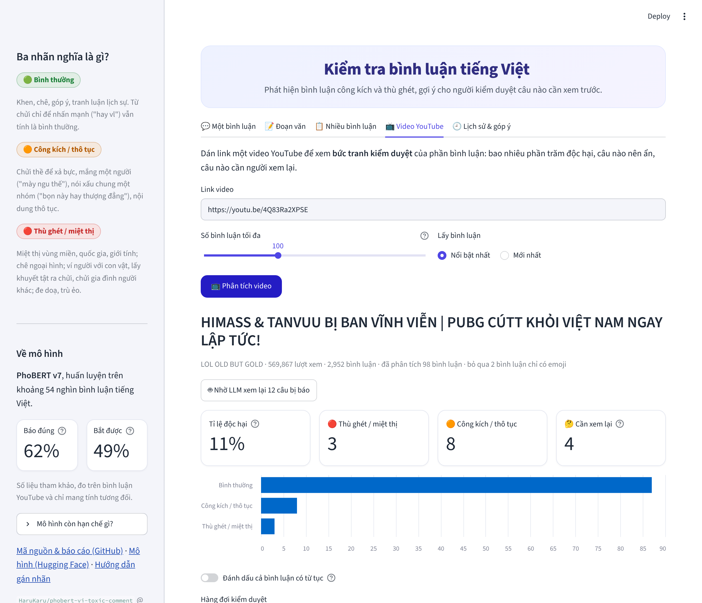
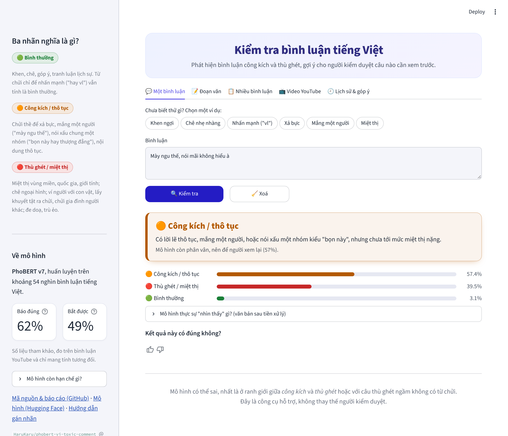
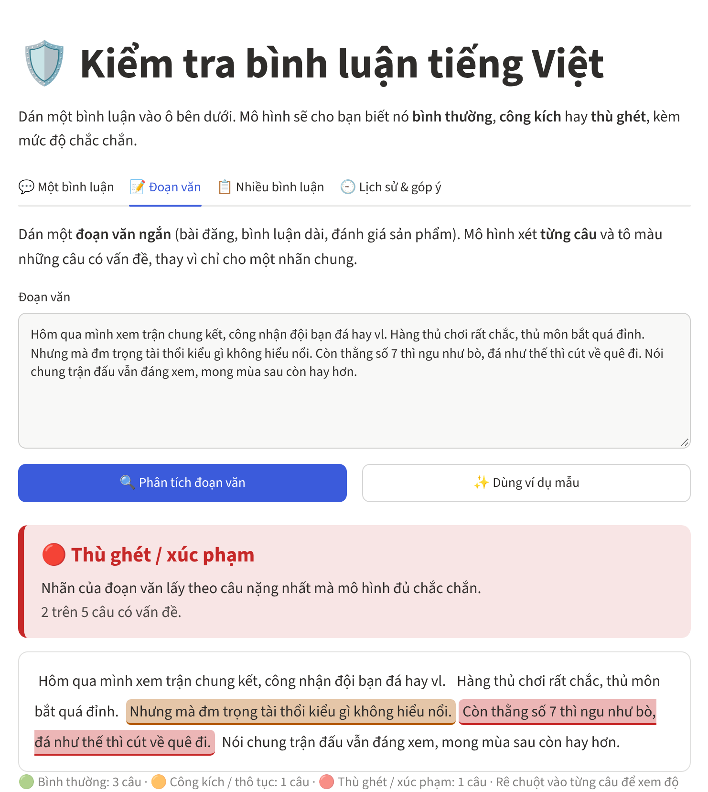
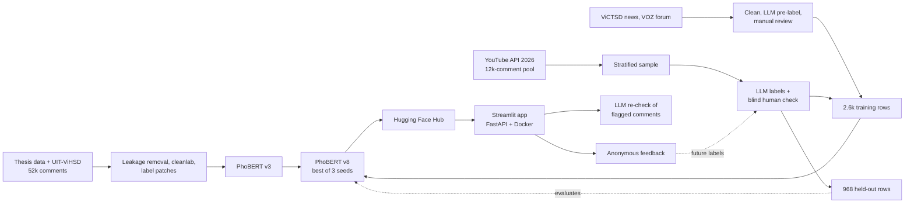

<h1 align="center">Vietnamese Toxic Comment Moderation</h1>

<p align="center">
  A moderation assistant for Vietnamese social-media comments: a fine-tuned PhoBERT classifier,<br>
  an optional LLM second opinion, and a web app that turns a YouTube comment section into a review queue.
</p>

<p align="center">
  <a href="https://github.com/Harukaru1/vietnamese-toxic-comment-moderation/actions/workflows/ci.yml"></a>
  <a href="https://vi-toxic-moderation.streamlit.app/"></a>
  <a href="https://huggingface.co/HaruKaru/phobert-vi-toxic-comment"></a>
  
  <a href="LICENSE"></a>
</p>

<p align="center"><b><a href="https://vi-toxic-moderation.streamlit.app/">Try the live demo →</a></b></p>

<p align="center"></p>

**Contents:** [What it does](#what-it-does) · [Results](#results) · [How it works](#how-it-works) ·
[How the project got here](#how-the-project-got-here) · [Limitations](#limitations) ·
[Quickstart](#quickstart) · [Data and licences](#data-and-licences) · [References](#references)

## What it does

Every comment gets one of three labels, defined in a written [annotation guideline](docs/annotation_guidelines.md):

| Label | Meaning | Example |
|---|---|---|
| **clean** | No one is insulted. Criticism, sarcasm and profanity used for emphasis are clean. | "Phim hay vl, xem 3 lần rồi" |
| **offensive** | An insult at a person, a sweeping remark about a group, or swearing in anger. | "Mày ngu thế, nói mãi không hiểu à" |
| **hate** | A severe attack: on who someone is, dehumanizing, or threatening. | "Bọn này ngu như chó, cút hết về nước đi" |

The web app has four modes: a **single comment** (label and per-class confidence), a **paragraph** (each
sentence highlighted), a **CSV file** (upload a `text` column, download it labeled) and a **YouTube video**
(paste a link, get the share of toxic comments and three queues: *suggest hiding*, *needs review*, *leave*,
with an optional LLM re-check and per-comment corrections). It is built to **prioritize a human
moderator's work**, not to remove comments on its own.

<p align="center">
  
  
</p>

## Results

The benchmark is **968 YouTube comments from 2026** that were never used for training or tuning. They are a
stratified sample of a 12k-comment pool, so scores are weighted back to the pool and describe real traffic,
where about 1 comment in 20 is toxic. The metric is toxic vs clean, the decision a moderator makes.

| Model | Precision | Recall | F1 |
|---|---:|---:|---:|
| PhoBERT v3: ~52k older comments | 0.36 | 0.44 | 0.40 |
| PhoBERT v7: v3 + 2k YouTube comments labeled under the final guideline | **0.62** | 0.49 | 0.55 |
| **PhoBERT v8** (deployed): v7 data + 1k news, forum and YouTube comments | 0.60 | **0.54** | **0.57** |

v7 gains +0.15 F1 over v3 (95% paired-bootstrap interval [+0.07, +0.24]). v8 adds a small +0.02 over v7
(CI [−0.03, +0.09]) that also shows on the author's blind labels, mostly as higher recall
([`reports/testset2_heldout.json`](reports/testset2_heldout.json)).

**Generative models** on the same comments, with the guideline in the prompt
([`reports/generative_vs_phobert.json`](reports/generative_vs_phobert.json)):

| Model | Precision | Recall | F1 | Cost |
|---|---:|---:|---:|---|
| PhoBERT v8 (135M parameters) | 0.60 | 0.54 | 0.57 | CPU, ~40 ms per comment |
| Gemini Flash-Lite, zero-shot | 0.62 | **0.87** | **0.72** | paid API, rate-limited |
| Qwen2.5-1.5B-Instruct, zero-shot | 0.19 | 0.16 | 0.17 | CPU, ~0.5 s per comment |
| Qwen2.5-1.5B-Instruct + QLoRA (best of 3 runs) | 0.38 | 0.51 | 0.43 | CPU, ~0.5 s per comment |

A large LLM finds far more toxic comments (+0.15 F1 over v8, CI [+0.02, +0.29]), and the lead holds on the
author's own blind labels (+0.07, CI [+0.01, +0.12]), so the reference labels (written by an LLM) are not the reason. A small open model
fine-tuned with QLoRA on the same 2.6k comments stays below PhoBERT, which also had 52k older comments behind it.

**LLM second opinion.** The app can send only the comments PhoBERT flags (about 6% of traffic) to Gemini. On
111 flagged comments labeled blind by the author, the share that is really toxic rises from **46% to 69%**
while 84% of the toxic ones are kept ([`reports/llm_second_stage.json`](reports/llm_second_stage.json)).

**Label quality.** An LLM (Claude) labeled the data; the author labeled 241 test comments blind: Cohen's κ
0.74 for toxic vs clean, 0.68 for three classes
([`reports/annotation_agreement_testset2.json`](reports/annotation_agreement_testset2.json)).

## How it works



| Component | Details | Code |
|---|---|---|
| Preprocessing | Unicode NFC, lowercase, URL/mention/emoji removal, repeated-letter squeezing, pyvi word segmentation | [`preprocess.py`](src/toxic_moderation/preprocess.py) |
| Classifier | `vinai/phobert-base-v2`; v8 continues v3 for 3 epochs at lr 1e-5 on the new labels only, best of 3 seeds | [`train_phobert.py`](scripts/train_phobert.py), [`notebooks/`](notebooks/) |
| Decision bands | P(toxic) ≥ 0.8 → suggest hiding; 0.4–0.8 → needs review; below → leave | [`streamlit_app.py`](streamlit_app/streamlit_app.py) |
| LLM stage | Gemini re-reads flagged comments with the guideline; retries on rate limits and timeouts | [`llm_check.py`](src/toxic_moderation/llm_check.py) |
| Local LLM | Qwen2.5 as a classifier (label-token scoring, cached prompt prefix) and its QLoRA fine-tune | [`llm_local.py`](src/toxic_moderation/llm_local.py), [`train_qwen_qlora.py`](scripts/train_qwen_qlora.py) |
| Swear-word flag | A separate word list, kept apart from the toxicity label (most comments with a swear word are clean) | [`profanity.py`](src/toxic_moderation/profanity.py) |
| Feedback | Votes and corrections stored anonymously (no name or IP, opt-out) in a private Hugging Face dataset | [`feedback_store.py`](src/toxic_moderation/feedback_store.py) |
| Evaluation | Inverse-probability weights, paired bootstrap for every comparison, Cohen's κ for every annotation round | [`eval_heldout.py`](scripts/eval_heldout.py) |

## How the project got here

The project started from a graduation-thesis prototype. Most of the work went into the data and the
measurement rather than the model.

1. **Leakage and label noise.** 4.7% of the test set also appeared in train (≈0.03 F1 of inflation);
   cleanlab flagged 5.5% of the labels, a third of a manual sample clearly wrong. Both fixed.
2. **A fresh test set.** A model at 0.80 F1 in-domain scored 0.59 on 1,000 comments collected in 2026.
3. **One root cause for the weak *offensive* class.** Comments with the intensifier "vl" were labeled
   52% clean, 25% offensive, 23% hate. A written guideline and a 772-label patch ([`relabels/`](relabels/))
   raised F1 on the 2026 set from 0.59 to 0.68 (v3).
4. **Negative results.** An active-learning batch (v4) and more label fixes (v5) stayed within noise of v3.
5. **A larger test set and blind checks.** 12k new YouTube comments, 2,000 labeled; three blind rounds by the
   author shaped and then froze the guideline ([v3.3](docs/annotation_guidelines.md)).
6. **What worked.** Older labels treat harsh criticism as toxic, so every earlier model raised two false
   alarms per real hit. Continuing v3 on ~2k comments labeled under the final guideline (v7), then on 1k
   more from news and a forum (v8), helped more than relabeling the 52k older ones.
7. **Generative models.** A zero-shot LLM beats every fine-tuned model on F1 and works best as a second
   stage; a 1.5B model fine-tuned with QLoRA does not reach PhoBERT on this amount of data.

<details>
<summary>Earlier benchmarks (older label definitions, three-class F1-macro)</summary>

| Model | In-domain test | 2026 set 1 | ViHSD test |
|---|---:|---:|---:|
| TF-IDF + Linear SVM | 0.799 | – | 0.616 |
| PhoBERT v1 (thesis data) | 0.780 | – | 0.643 |
| PhoBERT v2 (+ leakage removal, cleanlab, UIT-ViHSD) | 0.801 | 0.556 | 0.690 |
| PhoBERT v3 (+ guideline v3 patch) | 0.815 | 0.647 | 0.674 |

In-domain, TF-IDF and PhoBERT are tied; PhoBERT pulls ahead on unseen sources. Files: [`reports/earlier/`](reports/earlier/).
</details>

## Limitations

- **It prioritizes, it does not decide.** At precision 0.60 a person should confirm before anything is hidden.
- **One comment, no context.** "bạn mập quá đấy" can be teasing or body shaming.
- **Offensive vs hate is a judgement of severity.** The model separates toxic from clean far better than it
  separates the two toxic classes; the app shows that split as an indication only.
- **Subjective labels.** One LLM and one human, with measured agreement.
- **The LLM stage depends on an external API** and its rate limits.

## Quickstart

```bash
python -m venv .venv && source .venv/bin/activate
pip install -r requirements.txt -r requirements-app.txt && pip install -e .
pytest
```

```python
from toxic_moderation.predictor import Predictor

clf = Predictor(revision="v8")   # downloads HaruKaru/phobert-vi-toxic-comment from the Hugging Face Hub
clf.predict(["Video rất hay và bổ ích", "Thằng này dở hơi à, nói mãi không hiểu"])
# [{'label': 'clean', 'scores': {...}}, {'label': 'offensive', 'scores': {...}}]
```

```bash
streamlit run streamlit_app/streamlit_app.py                      # web app
uvicorn app.main:app --port 7860                                  # REST API, docs at /docs
docker build -t toxic-mod . && docker run -p 7860:7860 toxic-mod  # same API in Docker
```

Optional keys (Streamlit secrets or environment variables; the app works without them): `YOUTUBE_API_KEY`
for the YouTube tab, `GEMINI_API_KEY` for the LLM re-check, `HF_TOKEN` to save anonymous feedback.
Training runs on Kaggle GPUs with the notebooks in [`notebooks/`](notebooks/).

```
src/toxic_moderation/   preprocessing, predictor, LLM check, local LLM, swear-word flag, feedback, YouTube client
scripts/                data pipeline, training, evaluation, annotation agreement, sampling
notebooks/              Kaggle notebooks (PhoBERT v3, v8, QLoRA)
streamlit_app/, app/    Streamlit demo; FastAPI service + Gradio UI (Dockerfile at the root)
docs/, labels/, relabels/   annotation guideline, screenshots; labels and label patches (ids only, no text)
reports/                JSON results behind every number in this README
```

## Data and licences

The **code** is MIT-licensed; the licence does not cover any data. **No comment text is published**: only
code, aggregate results and labels keyed by public ids or row indices. The thesis data is private; UIT-ViHSD
(CC BY-NC-SA 4.0), ViCTSD and VOZ-HSD are research datasets; YouTube comments are collected through the
official API and not redistributed, and author names are never stored. Because the training data is for
research use, the model weights are shared for research and non-commercial use.

## References

- D. Q. Nguyen and A. T. Nguyen. *PhoBERT: Pre-trained language models for Vietnamese.* Findings of EMNLP, 2020.
- S. T. Luu, K. V. Nguyen and N. L.-T. Nguyen. *A Large-scale Dataset for Hate Speech Detection on Vietnamese Social Media Texts* (UIT-ViHSD). IEA/AIE, 2021.
- L. T. Nguyen, K. V. Nguyen and N. L.-T. Nguyen. *Constructive and Toxic Speech Detection for Open-domain Social Media Comments in Vietnamese* (ViCTSD). IEA/AIE, 2021.
- L. T. Nguyen. *ViHateT5: Enhancing Hate Speech Detection in Vietnamese with a Unified Text-to-Text Transformer Model* (VOZ-HSD). Findings of ACL, 2024.
- C. G. Northcutt, L. Jiang and I. L. Chuang. *Confident Learning: Estimating Uncertainty in Dataset Labels.* JAIR, 2021.
- E. J. Hu et al. *LoRA: Low-Rank Adaptation of Large Language Models.* ICLR, 2022.
- T. Dettmers et al. *QLoRA: Efficient Finetuning of Quantized LLMs.* NeurIPS, 2023.
- Qwen Team. *Qwen2.5 Technical Report.* arXiv:2412.15115, 2024.
- M. Zampieri et al. *Predicting the Type and Target of Offensive Posts in Social Media* (OLID). NAACL, 2019.
- P. Koehn. *Statistical Significance Tests for Machine Translation Evaluation* (paired bootstrap). EMNLP, 2004.
- J. Cohen. *A Coefficient of Agreement for Nominal Scales.* Educational and Psychological Measurement, 1960.
